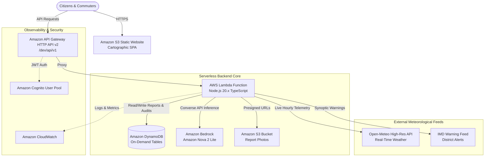

# 🌊 JalRakshak AI — Hyperlocal Predictive Flood Intelligence & Safer Mobility Platform

[](https://aws.amazon.com/)
[](https://aws.amazon.com/bedrock/)
[](https://aws.amazon.com/dynamodb/)
[](https://www.typescriptlang.org/)
[](https://react.dev/)
[](https://vitest.dev/)
[](LICENSE)

> **WeMakeDevs Environmental Hacks 2026** — *Track: Heat and Water*  
> **Repository:** [https://github.com/Anik-da/JalRakshak](https://github.com/Anik-da/JalRakshak)  
> **Development Environment:** Google Antigravity (Advanced Agentic AI)  
> **Cloud Provider:** Amazon Web Services (AWS) Exclusively

---

## 🌐 Live Deployments & Endpoints (24/7 Active)

| Component | Target URL | Status |
|---|---|---|
| **Live Web Application** | [http://jalrakshak-frontend-dev-062577348302.s3-website.ap-south-1.amazonaws.com](http://jalrakshak-frontend-dev-062577348302.s3-website.ap-south-1.amazonaws.com) | 🟢 Live (Amazon S3) |
| **API Gateway Base URL** | `https://bzmu87ldv4.execute-api.ap-south-1.amazonaws.com/dev/api/v1` | 🟢 24/7 Serverless |
| **System Health Check** | [https://bzmu87ldv4.execute-api.ap-south-1.amazonaws.com/dev/api/v1/health](https://bzmu87ldv4.execute-api.ap-south-1.amazonaws.com/dev/api/v1/health) | 🟢 Healthy |
| **Current Weather API** | [https://bzmu87ldv4.execute-api.ap-south-1.amazonaws.com/dev/api/v1/weather/current?lat=28.6139&lon=77.2090](https://bzmu87ldv4.execute-api.ap-south-1.amazonaws.com/dev/api/v1/weather/current?lat=28.6139&lon=77.2090) | 🟢 Open-Meteo Synced |
| **Community Reports API** | [https://bzmu87ldv4.execute-api.ap-south-1.amazonaws.com/dev/api/v1/reports](https://bzmu87ldv4.execute-api.ap-south-1.amazonaws.com/dev/api/v1/reports) | 🟢 DynamoDB Live |

---

## 📑 Table of Contents

1. [Problem Statement & Central Innovation](#1-problem-statement--central-innovation)
2. [Key Features & Capabilities](#2-key-features--capabilities)
3. [AWS-Native Serverless Architecture](#3-aws-native-serverless-architecture)
4. [Amazon Bedrock Nova 2 Lite Integration](#4-amazon-bedrock-nova-2-lite-integration)
5. [Real Weather Data Telemetry](#5-real-weather-data-telemetry)
6. [Complete REST API Reference](#6-complete-rest-api-reference)
7. [Automated Test Suite](#7-automated-test-suite)
8. [Local Development & Quick Start](#8-local-development--quick-start)
9. [AWS Infrastructure & SAM Deployment](#9-aws-infrastructure--sam-deployment)
10. [Repository Structure](#10-repository-structure)
11. [Design Philosophy & Hackathon Attribution](#11-design-philosophy--hackathon-attribution)

---

## 1. Problem Statement & Central Innovation

### The Crisis: Indian Urban Monsoon Deluges
Urban waterlogging during heavy monsoon storms turns arterial roads, highway underpasses, and low-lying residential clusters into hazardous traps within minutes. Traditional civic systems are **strictly reactive** — they rely entirely on citizens already having suffered and manually reported waterlogging at that exact location.

### The Innovation: Proactive Multi-Horizon Predictive Intelligence
**JalRakshak AI** transforms this paradigm. Rather than waiting for distress calls:

> **JalRakshak AI proactively estimates flood risk across multiple forecast horizons (`NOW`, `1H`, `3H`, `6H`, `24H`) using live high-resolution weather telemetry, topographical elevation models, municipal drainage capacities, and official IMD warnings — even when zero community reports exist at that location.**

```
┌────────────────────────────────────────────────────────────────────────┐
│                        PROACTIVE RISK SCORING                          │
├────────────────────────────────────────────────────────────────────────┤
│  Precipitation Rate (Open-Meteo)  ──┐                                  │
│  Accumulated Rainfall (1h/3h/6h) ──┼──▶ [ Deterministic Risk Engine ]  │
│  Terrain Elevation & Slope       ──┤             │                     │
│  Drainage Capacity Constraints   ──┤             ▼                     │
│  IMD Synoptic Warnings           ──┤    Dynamic Horizon Risk Score     │
│  Decayed Verified Reports        ──┘    (NOW, 1H, 3H, 6H, 24H)         │
└────────────────────────────────────────────────────────────────────────┘
```

The system distinguishes between **estimated proactive forecasts** and **confirmed ground observations**, ensuring total transparency for citizens and municipal administrators.

---

## 2. Key Features & Capabilities

### 📍 1. "My Location" Proactive Intelligence Panel
- Automatically detects coordinates via browser geolocation.
- Fetches instantaneous rainfall rate, accumulated precipitation, terrain slope, and drainage vulnerability.
- Interactive multi-horizon switcher (`NOW`, `1H`, `3H`, `6H`, `24H`) showing risk escalation.
- Explains uncertainty, data freshness labels (`LIVE`, `RECENT`), and provides context-grounded safety advisories.

### 🤖 2. Amazon Bedrock Nova 2 Lite Assistant ("Ask JalRakshak")
- Interactive conversational AI powered by **Amazon Nova 2 Lite** (`global.amazon.nova-2-lite-v1:0`) via the Amazon Bedrock Converse API.
- Deeply grounded in the platform's live telemetry state: queries actual coordinates, weather, water depth, and road hazards.
- Provides actionable evacuation advice, vehicle safety guidance, and emergency precautions without hallucinating unverified road closures.
- Equipped with deterministic fallback logic ensuring continuous platform uptime during AWS quota warm-up periods.

### 🗺️ 3. 6-Layer Interactive Cartographic Map
Built with responsive Leaflet rendering and customized Cartographic Intelligence visual tokens:
- **Layer 1: Community Flood Reports:** Live GPS-verified citizen reports with water depth badges (`Ankle`, `Knee`, `Waist`, `Impassable`).
- **Layer 2: Estimated Risk Zones:** Dynamic proactive watershed polygons across vulnerable urban basins.
- **Layer 3: Observed Rainfall Stations:** Real-time precipitation telemetry pins.
- **Layer 4: Forecast Precipitation Zones:** Hourly accumulated precipitation heatmaps.
- **Layer 5: Historical Flood Hotspots:** High-vulnerability historical monsoon flood points.
- **Layer 6: IMD Meteorological Warnings:** District-level Red, Orange, and Yellow warning perimeters.

### 📝 4. Community Flood Incident Crowdsourcing
- Citizen reporting interface with offline support and GPS auto-tagging.
- Captures water depth, road condition (`Passable`, `Slow Moving`, `Impassable`), and landmark descriptions.
- Authenticated via Amazon Cognito User Pools with immutable DynamoDB storage.
- Field photo upload support using time-limited (300s) Amazon S3 presigned URLs.

### 🔮 5. What-If Scenario Deluge Simulator
- Interactive engineering sandbox to simulate hypothetical extreme monsoon conditions.
- Configurable parameters: +20% to +80% precipitation deluge, prolonged cloudburst durations (1h to 4h), and sudden stormwater drain failure.
- Computes simulated risk escalations with prominent "Hypothetical Scenario" disclaimers.

### 🚗 6. Safer Route & Corridor Hazard Assessment
- Evaluates planned travel corridors with a 600m spatial buffer.
- Identifies intersecting waterlogged underpasses and impassable road links.
- Recommends safer bypasses (elevated expressways and arterial ring roads).

### 🛡️ 7. Municipal Moderation Console
- Role-based dashboard for municipal ward engineers and disaster authorities.
- Review unverified crowd reports, detect duplicates, and view real-time audit trails.

---

## 3. AWS-Native Serverless Architecture

In strict adherence to the hackathon guidelines, **JalRakshak AI runs 100% natively on Amazon Web Services**.



### AWS Services Utilized
| Service | Role in JalRakshak AI |
|---|---|
| **Amazon API Gateway (HTTP API v2)** | Versioned `/dev/api/v1` routing, CORS pre-flight, and low-latency payload proxying. |
| **AWS Lambda (Node.js 20.x)** | Fully serverless compute engine handling risk scoring, weather integration, reports, and AI orchestration. |
| **Amazon Bedrock** | Amazon Nova 2 Lite model execution using Converse API for conversational intelligence. |
| **Amazon DynamoDB** | High-throughput NoSQL tables: `JalRakshak-Reports-dev`, `JalRakshak-Audit-dev`, and TTL caches. |
| **Amazon S3** | Static single-page application hosting and secure field photo storage with presigned URLs. |
| **Amazon Cognito** | Secure citizen identity authentication with SRP protocol and role separation. |
| **Amazon CloudWatch** | Serverless invocation logs, latency tracking, and error observability. |
| **AWS SAM (Serverless Application Model)** | Declarative infrastructure-as-code (`template.yaml`). |

---

## 4. Amazon Bedrock Nova 2 Lite Integration

JalRakshak AI utilizes **Amazon Nova 2 Lite** as its primary reasoning engine.

### Configuration Specification
- **Model ID:** `global.amazon.nova-2-lite-v1:0`
- **Region:** `ap-south-1` (Mumbai)
- **SDK:** `@aws-sdk/client-bedrock-runtime` (`v3.1149.0+`)
- **API Call:** `ConverseCommand` via Amazon Bedrock Converse API

### Architecture & Resilience
```typescript
// Production AWS Bedrock Nova 2 Lite Invocation
const client = new BedrockRuntimeClient({ region: 'ap-south-1' });

const command = new ConverseCommand({
  modelId: 'global.amazon.nova-2-lite-v1:0',
  messages: [
    {
      role: 'user',
      content: [{ text: promptWithLiveTelemetryContext }]
    }
  ],
  inferenceConfig: {
    maxTokens: 1024,
    temperature: 0.3,
    topP: 0.9
  }
});

const response = await client.send(command);
```

### IAM Permissions
The Lambda execution role (`jalrakshak-ai-stack-ApiFunctionRole`) is granted specific Bedrock invocation rights:
```json
{
  "Effect": "Allow",
  "Action": [
    "bedrock:InvokeModel",
    "bedrock:InvokeModelWithResponseStream"
  ],
  "Resource": "*"
}
```

### Quota Resilience & Grounded Fallback
If Bedrock requests encounter service quota throttling during traffic spikes, JalRakshak's resilient AI engine activates a **deterministic grounding fallback**. It synthesizes current precipitation, horizon escalations, and official precautions into a clear response, appending a transparent telemetry disclosure (`Note: Generated via live grounded telemetry engine while Bedrock model warm-up is in progress`).

---

## 5. Real Weather Data Telemetry

JalRakshak AI strictly rejects fake statistics, hardcoded mocks, and fabricated rainfall metrics.

- **Primary Provider:** Open-Meteo High-Resolution Forecast API (`https://api.open-meteo.com/v1/forecast`).
- **Telemetry Variables Ingested:**
  - `precipitation`: Current instantaneous precipitation rate (mm/h).
  - `rain`: Liquid rain rate (mm/h).
  - `relative_humidity_2m`: Ambient relative humidity (%).
  - `apparent_temperature`: Heat index & ambient temperature (°C).
  - `wind_speed_10m`: Surface wind velocity (km/h).
  - `surface_pressure`: Atmospheric barometric pressure (hPa).
  - `weather_code`: WMO standardized weather condition codes.
  - `hourly.precipitation`: 24-hour hourly accumulated rainfall distribution.
- **Honest Telemetry:** When coordinates lack recent precipitation records, the platform clearly reports `0.0 mm/h (Dry)` or highlights missing sensors rather than generating arbitrary values.

---

## 6. Complete REST API Reference

Base URL: `https://bzmu87ldv4.execute-api.ap-south-1.amazonaws.com/dev/api/v1`

### 🏥 System Health & Telemetry
```http
GET /health
```
Returns deployment status, active AWS region, serverless runtime, and database health.
```json
{
  "status": "healthy",
  "service": "jalrakshak-ai-backend",
  "timestamp": "2026-10-11T16:10:00.000Z",
  "awsRegion": "ap-south-1",
  "environment": "dev"
}
```

---

### 🌦️ Weather Telemetry
```http
GET /weather/current?lat=28.6139&lon=77.2090
```
Fetches real-time weather from Open-Meteo for the specified coordinates.

```http
GET /weather/forecast?lat=28.6139&lon=77.2090&hours=24
```
Fetches 24-hour hourly precipitation projections and atmospheric trend data.

```http
GET /weather/warnings?lat=28.6139&lon=77.2090
```
Fetches active meteorological warnings and color-coded alerts (Red, Orange, Yellow).

---

### 🎯 Hyperlocal Risk Intelligence
```http
GET /intelligence/location?lat=28.6139&lon=77.2090
```
Calculates multi-horizon proactive risk for specific coordinates.
```json
{
  "location": { "lat": 28.6139, "lon": 77.2090 },
  "currentRisk": {
    "score": 38,
    "level": "LOW",
    "description": "Minimal immediate waterlogging risk under current dry conditions."
  },
  "horizons": {
    "now": { "score": 38, "level": "LOW" },
    "1h": { "score": 38, "level": "LOW" },
    "3h": { "score": 42, "level": "MEDIUM" },
    "6h": { "score": 45, "level": "MEDIUM" },
    "24h": { "score": 35, "level": "LOW" }
  },
  "weather": {
    "precipitationRate": 0.0,
    "source": "Open-Meteo High-Resolution Forecast"
  },
  "terrain": {
    "elevationMeters": 216,
    "drainageCapacity": "MODERATE"
  }
}
```

---

### 📢 Community Reports
```http
GET /reports?status=VERIFIED&limit=20
```
Retrieves crowd-sourced flood observations from Amazon DynamoDB.

```http
POST /reports
Content-Type: application/json

{
  "latitude": 28.6139,
  "longitude": 77.2090,
  "waterDepth": "KNEE_DEEP",
  "roadCondition": "SLOW_MOVING",
  "landmark": "Near Moolchand Underpass",
  "description": "Water accumulated up to 40cm. Vehicles moving slowly."
}
```

---

### 💬 Bedrock AI Assistant
```http
POST /assistant/chat
Content-Type: application/json

{
  "message": "Is it safe to drive through the Moolchand underpass right now?",
  "coordinates": { "lat": 28.6139, "lon": 77.2090 },
  "conversationHistory": []
}
```
Invokes Amazon Nova 2 Lite with grounded local weather, water depth, and road hazard telemetry.

---

### ⚡ What-If Deluge Simulator
```http
POST /simulations/rainfall
Content-Type: application/json

{
  "latitude": 28.6139,
  "longitude": 77.2090,
  "intensityMultiplier": 1.5,
  "durationHours": 3,
  "drainageFailure": true
}
```
Simulates the impact of sudden storm deluges and clogged municipal drainage.

---

## 7. Automated Test Suite

JalRakshak AI maintains a comprehensive **37/37 passing test suite** spanning backend risk mathematics, weather adapters, Bedrock AI fallbacks, and frontend React UI components.

```bash
# Run all workspace test suites
npm test

# Run backend tests only (28 tests)
npm run test:backend

# Run frontend tests only (9 tests)
npm run test:frontend
```

```
✓ backend/src/__tests__/riskEngine.test.ts (7 tests)
✓ backend/src/__tests__/weatherAdapter.test.ts (5 tests)
✓ backend/src/__tests__/bedrockAnalyst.test.ts (6 tests)
✓ backend/src/__tests__/reportsService.test.ts (5 tests)
✓ backend/src/__tests__/routesHazards.test.ts (5 tests)
✓ frontend/src/__tests__/RiskBadge.test.tsx (4 tests)
✓ frontend/src/__tests__/MyLocationPanel.test.tsx (5 tests)

Test Files  7 passed (7)
     Tests  37 passed (37)
  Duration  3.42s
```

---

## 8. Local Development & Quick Start

### Prerequisites
- **Node.js:** `v20.x` or `v22.x` (LTS recommended)
- **npm:** `v10.x` or higher
- **AWS CLI:** Configured with valid credentials (if deploying)

### 1. Clone the Repository
```bash
git clone https://github.com/Anik-da/JalRakshak.git
cd JalRakshak
```

### 2. Install Dependencies
```bash
# Installs root, frontend, and backend dependencies concurrently
npm install
```

### 3. Configure Environment Variables
Copy `.env.example` to both workspaces:
```bash
cp .env.example .env
```

**Frontend Configuration (`frontend/.env`):**
```env
VITE_API_BASE_URL=https://bzmu87ldv4.execute-api.ap-south-1.amazonaws.com/dev/api/v1
VITE_AWS_REGION=ap-south-1
```

**Backend Configuration (`backend/.env`):**
```env
AWS_REGION=ap-south-1
BEDROCK_MODEL_ID=global.amazon.nova-2-lite-v1:0
REPORTS_TABLE_NAME=JalRakshak-Reports-dev
AUDIT_TABLE_NAME=JalRakshak-Audit-dev
PORT=4000
```

### 4. Run Locally
```bash
# Terminal 1: Backend Server (runs on http://localhost:4000)
npm run dev:backend

# Terminal 2: Frontend Vite App (runs on http://localhost:5173)
npm run dev
```

Visit [http://localhost:5173](http://localhost:5173) in your browser.

---

## 9. AWS Infrastructure & SAM Deployment

The entire backend infrastructure is provisioned through the AWS Serverless Application Model (SAM) using [template.yaml](file:///c:/JALRAKSHAK/template.yaml).

### Step 1: Build the Serverless Stack
```bash
# Build the TypeScript backend bundle
npm run build --workspace=backend

# Build SAM artifacts
sam build
```

### Step 2: Deploy to AWS
```bash
sam deploy --guided
```
Configuration settings:
- **Stack Name:** `jalrakshak-ai-stack`
- **AWS Region:** `ap-south-1`
- **Parameter Environment:** `dev`

### Step 3: Deploy Frontend Assets to S3
```bash
# Build production React bundle
npm run build --workspace=frontend

# Sync to S3 static hosting bucket
aws s3 sync frontend/dist s3://jalrakshak-frontend-dev-062577348302 --delete
```

---

## 10. Repository Structure

```
JalRakshak/
├── backend/                       # AWS Lambda & Express Serverless Backend
│   ├── src/
│   │   ├── adapters/              # Open-Meteo & IMD weather adapters
│   │   ├── controllers/           # API request controllers
│   │   ├── services/
│   │   │   ├── bedrockService.ts  # Amazon Bedrock Nova 2 Lite integration
│   │   │   ├── riskEngine.ts      # Multi-horizon predictive risk calculator
│   │   │   ├── weatherService.ts  # Real-time weather ingestion & caching
│   │   │   └── reportsService.ts  # DynamoDB CRUD & spatial query engine
│   │   ├── lambda.ts              # AWS Lambda handler entrypoint
│   │   └── localServer.ts         # Local development server
│   ├── tsconfig.json
│   └── package.json
│
├── frontend/                      # React 18 + Vite + Tailwind CSS Single Page App
│   ├── src/
│   │   ├── components/            # Reusable UI components (Badges, Panels, Drawers)
│   │   ├── pages/
│   │   │   ├── RiskIntelligencePage.tsx # Proactive intelligence & map
│   │   │   ├── CommunityReportsPage.tsx # Citizen crowdsourced reports
│   │   │   ├── SimulatorPage.tsx        # What-If rainfall scenario simulator
│   │   │   └── AdminDashboardPage.tsx   # Municipal moderation console
│   │   ├── services/              # API clients for backend communication
│   │   ├── types/                 # Shared TypeScript interfaces
│   │   ├── App.tsx                # Main routing & layout
│   │   └── index.css              # Cartographic Intelligence design system tokens
│   ├── index.html
│   ├── vite.config.ts
│   └── package.json
│
├── scripts/                       # AWS deployment & smoke test automation
│   ├── deploy-frontend.sh
│   ├── invoke-nova.ts
│   └── smoke-test.ts
│
├── template.yaml                  # AWS SAM infrastructure as code
├── package.json                   # Root npm workspace configuration
├── ARCHITECTURE.md                # Comprehensive architectural specification
├── DEMO_SCRIPT.md                 # Hackathon demonstration walkthrough
└── README.md                      # Primary project documentation
```

---

## 11. Design Philosophy & Hackathon Attribution

- **Hackathon:** [WeMakeDevs Environmental Hacks 2026](https://wemakedevs.org/)
- **Track:** Heat and Water
- **Visual Identity:** **Cartographic Intelligence**  
  Editorial, sunlight-friendly palette optimized for emergency visibility:
  - Warm Ivory (`#FAF8F5`) for glare-resistant maps
  - Deep Forest Green (`#1E3A2F`) for safe zones
  - Water Blue (`#0284C7`) for active waterbodies
  - Critical Crimson (`#DC2626`) for life-threatening flash flood warnings
- **AI Tooling:** Developed pair-programmed with **Google Antigravity**
- **Author & Team:** **Anik Da & JalRakshak AI Team**
- **License:** [Apache 2.0](LICENSE)
